# KREAM 클론코딩

한정판 리셀 플랫폼 [KREAM](https://kream.co.kr)을 따라 만든 팀 프로젝트입니다.
구매·판매 입찰로 거래가 이루어지는 쇼핑 기능과 SNS형 스타일 피드, 운영용 관리자 페이지를 구현했습니다.


- **개발 기간**: 2021.07.30 ~ 2021.10.31 (리팩토링 2022.01)
- **형태**: 팀 프로젝트
- **담당**: 프론트엔드 + 백엔드 (리팩토링 과정에서 Service 계층 개선 참여)

<br/>

## 기술 스택

| 구분 | 사용 기술 |
| --- | --- |
| Backend | Java, Spring Boot 2.5, Spring Security, JPA/Hibernate, QueryDSL, REST API |
| Frontend | HTML5, CSS3, JavaScript(ES6), jQuery, Ajax, axios, Thymeleaf |
| Database | Oracle |
| 외부 연동 | Mail API, SMS API, 네이버 로그인 |
| Tools | IntelliJ, Visual Studio Code, Git/GitHub |

<br/>

## 주요 기능

### 사용자 페이지
- **입찰 시스템**: 사이즈별 구매 입찰 / 판매 입찰, 즉시 구매·즉시 판매
- **시세 정보**: 상품별 최근 거래가와 평균 가격
- **상품 검색**: 브랜드·카테고리·가격 등을 조합하는 다중 필터
- **스타일(SNS)**: 게시물 등록·수정, 좋아요·댓글·팔로우, 해시태그별 모아보기
- **마이페이지**: 구매/판매 내역, 관심 상품, 프로필·주소록·결제 정보·정산 계좌 관리
- **고객센터**: 공지사항, FAQ, 1:1 문의

### 관리자 페이지
- **대시보드**: 주문·매출·회원 현황 요약
- **회원 관리**: 전체 회원 / 탈퇴 회원 / 블랙리스트
- **주문·배송 관리**: 주문 조회, 결제 확인, 배송 현황
- **상품 관리**: 상품 등록·수정, 게시 상태 관리
- **콘텐츠 관리**: 공지사항, 상품·고객 문의 답변

<br/>

## 담당 역할

### 프론트엔드
- 사용자 페이지 중 **마이페이지, 스타일, 게시판, 서비스 소개** 화면을 HTML/CSS/JS로 구현
- 공지사항, 스타일 **해시태그별 게시물 조회** 기능을 API와 연동
- **관리자 메인 대시보드**에 axios로 통계 데이터를 불러와 표시

### 백엔드 (리팩토링)
- 프로젝트 종료 후 진행한 **Service 계층 리팩토링**에 참여 ([리팩토링](#리팩토링) 참고)
- 공개 저장소 정리 과정에서 SMS·DB·메일·네이버 로그인 등 **민감한 설정값을 외부 설정 파일로 분리**하고, 하드코딩된 로컬 경로를 프로젝트 기준 경로로 수정

<br/>

## 프로젝트 구조

```
src/main/java/com/project/kream
├── Controller        # 페이지 라우팅(BaseController) + REST API(RestController/*)
├── Service           # 도메인별 비즈니스 로직
├── Repository        # JPA Repository, QueryDSL, Specification(다중 필터)
├── Model
│   ├── Entity        # JPA 엔티티
│   ├── request       # 요청 DTO
│   ├── response      # 응답 DTO
│   └── enumclass     # 상태·유형 enum
├── Security          # Spring Security 폼 로그인, 인증 성공/실패 핸들러
└── ifs               # 공통 CRUD 인터페이스

src/main/resources
├── templates         # Thymeleaf 화면 (board: 사용자, pages: 관리자)
└── static/lib        # CSS, JS, 이미지, 에디터 라이브러리
```

<br/>

## ERD

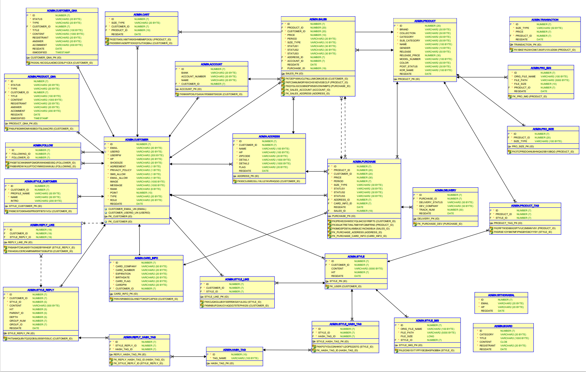

<br/>

## 실행 환경 설정

DB 접속 정보와 외부 API 키는 저장소에 포함하지 않습니다.
예시 파일을 복사한 뒤 실제 값을 채워 넣으세요.

```bash
cp src/main/resources/application-local.properties.example src/main/resources/application-local.properties
```

| 항목 | 설명 |
| --- | --- |
| `spring.datasource.*` | Oracle DB 접속 정보 |
| `spring.mail.*` | 메일 발송 계정 |
| `sms.*` | SMS 발송 API 키와 발신 번호 |
| `naver.client-id` | 네이버 로그인 Client ID |

`application-local.properties`는 `.gitignore`에 등록되어 있어 커밋되지 않습니다.

<br/>

## 화면 구성

### 사용자 페이지

<details open>
<summary><b>메인</b> <code>/</code></summary>

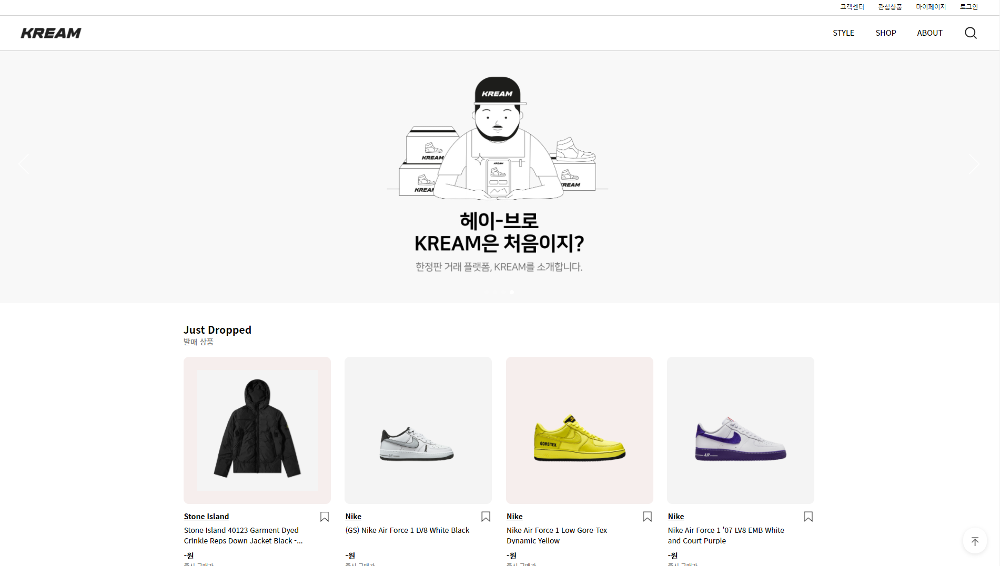
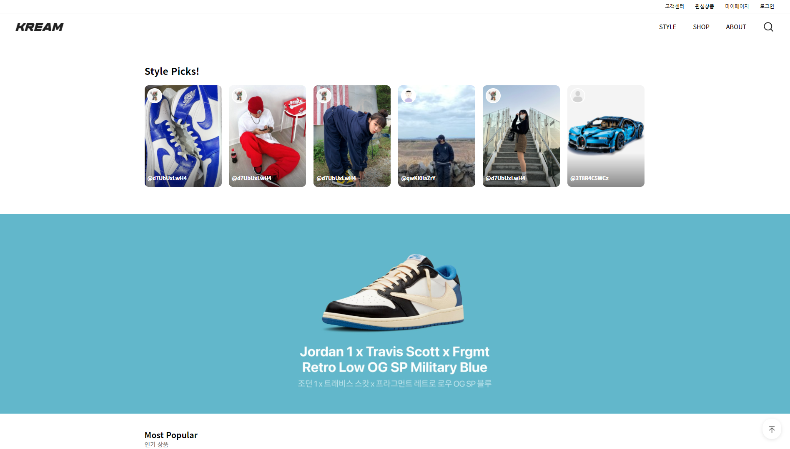
</details>

<details>
<summary><b>로그인</b> <code>/login</code></summary>

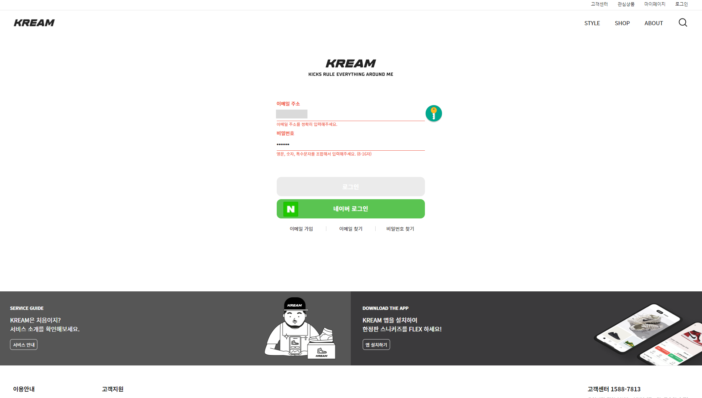
</details>

<details>
<summary><b>상품 목록</b> <code>/search</code></summary>

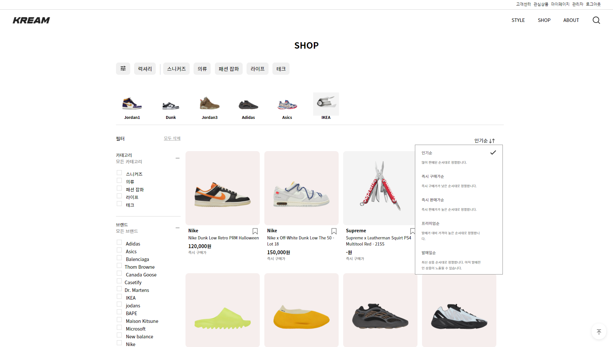
</details>

<details>
<summary><b>상품 상세 · 입찰</b> <code>/product/{id}</code>, <code>/kream/buying/{id}/{size}</code></summary>

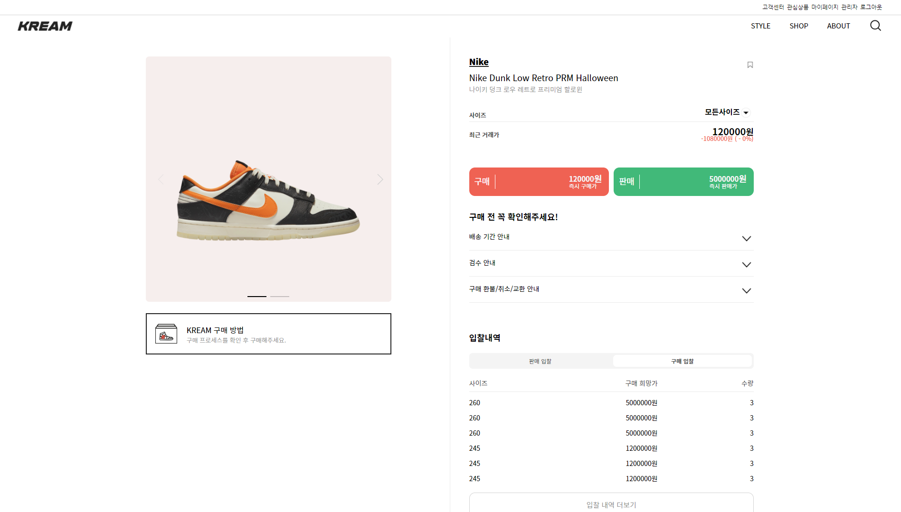
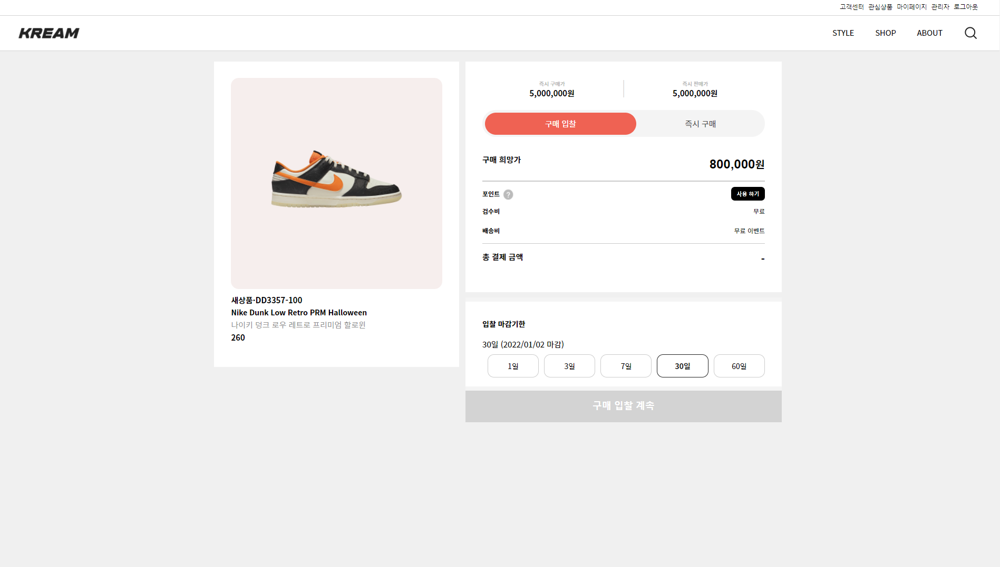
</details>

<details>
<summary><b>스타일</b> <code>/social/trending</code></summary>

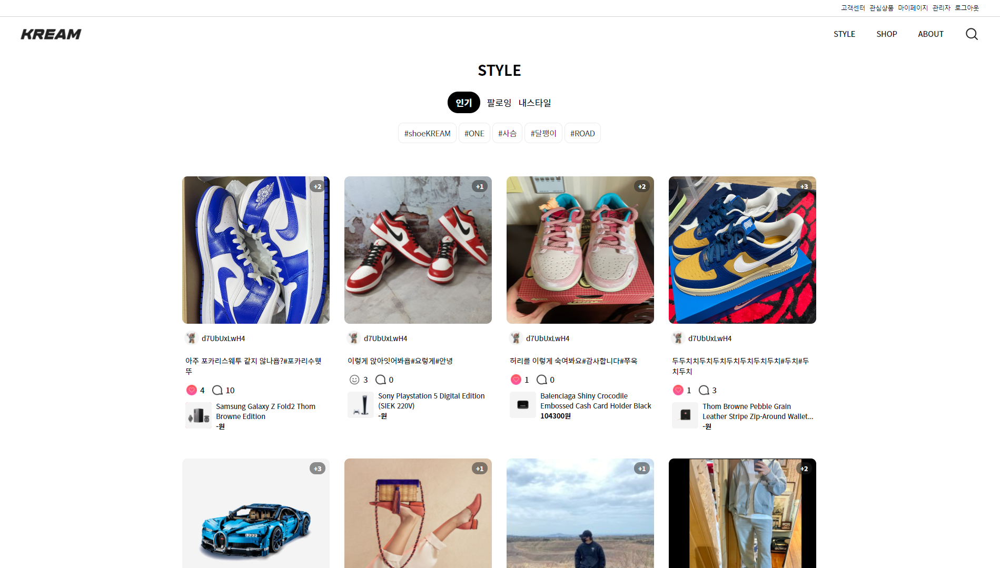
</details>

<details>
<summary><b>스타일 게시물 상세</b> <code>/social/popular</code></summary>

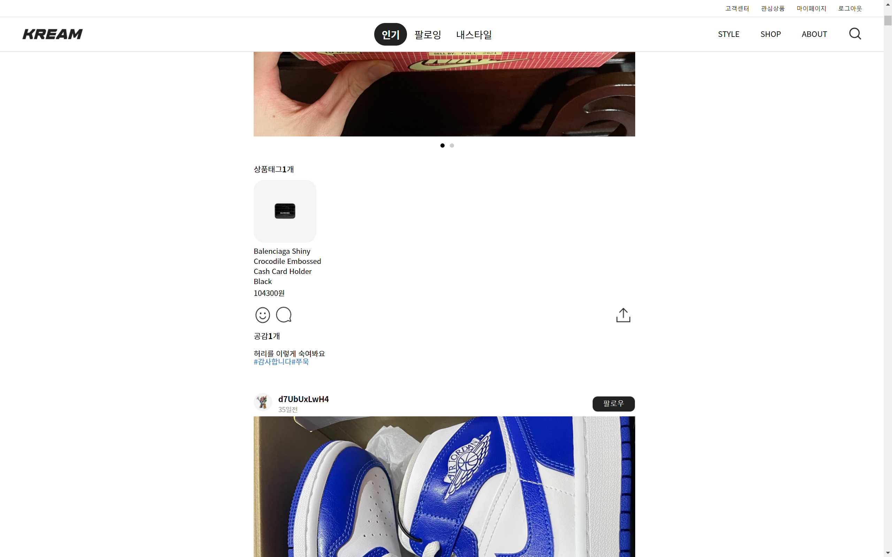
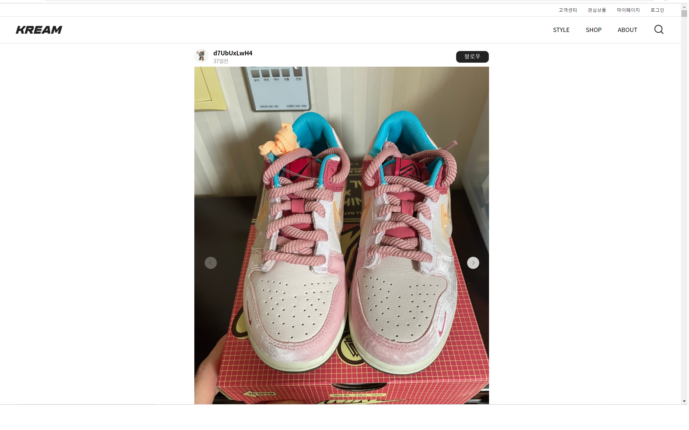
</details>

<details>
<summary><b>마이페이지</b> <code>/my</code></summary>

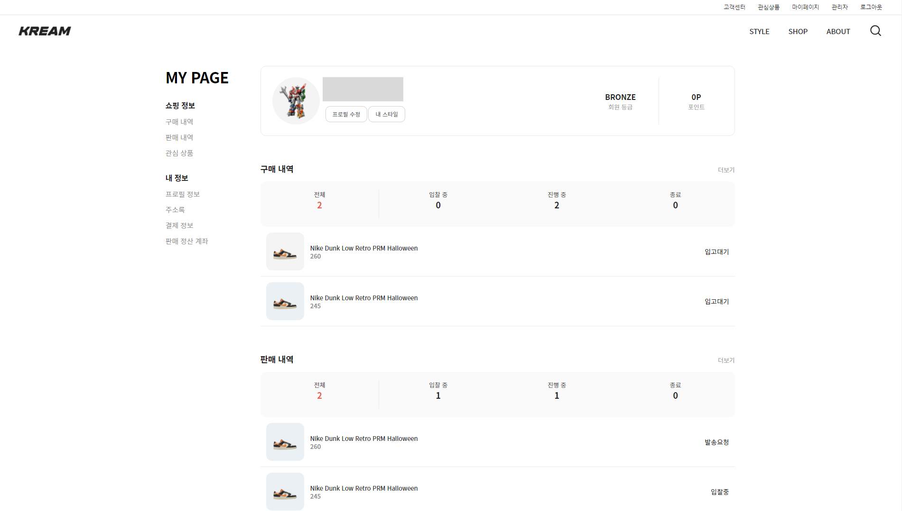
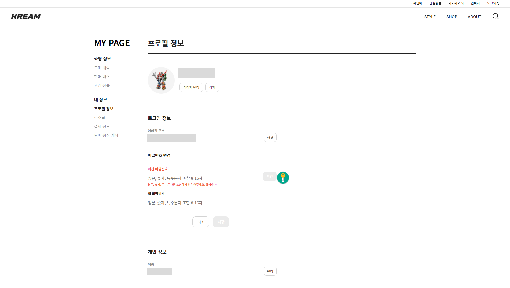
</details>

### 관리자 페이지

<details>
<summary><b>대시보드</b> <code>/pages</code></summary>

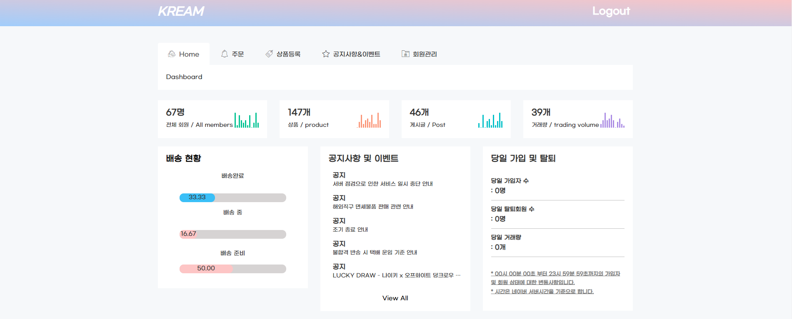
</details>

<details>
<summary><b>주문 조회</b> <code>/pages/order/search</code></summary>

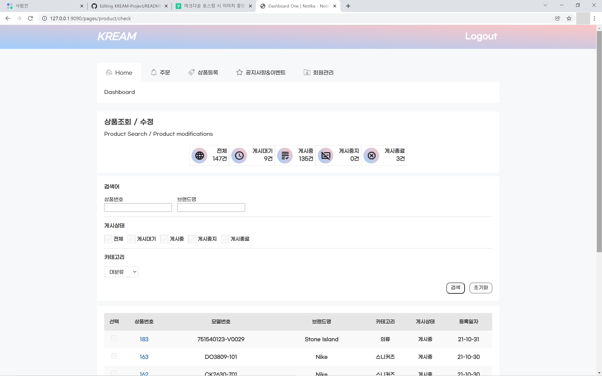
</details>

<details>
<summary><b>상품 관리</b> <code>/pages/product/check</code></summary>

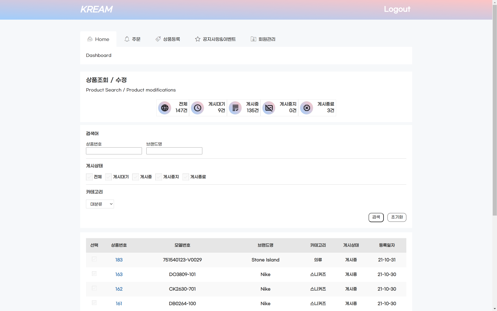
</details>

<details>
<summary><b>공지사항 관리</b> <code>/pages/content/manage</code></summary>

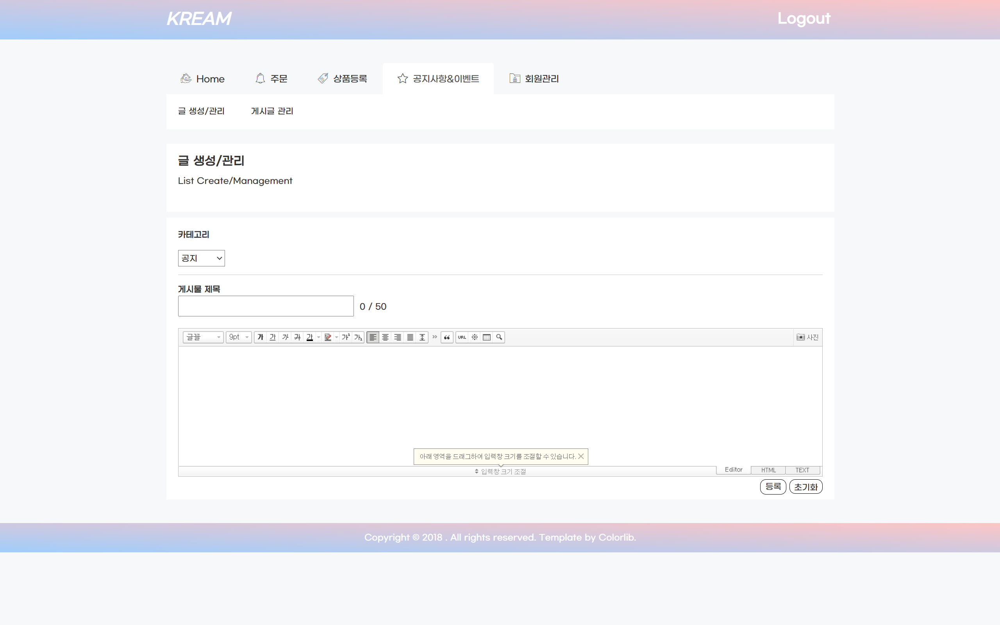
</details>

<details>
<summary><b>회원 관리</b> <code>/pages/member/all</code></summary>

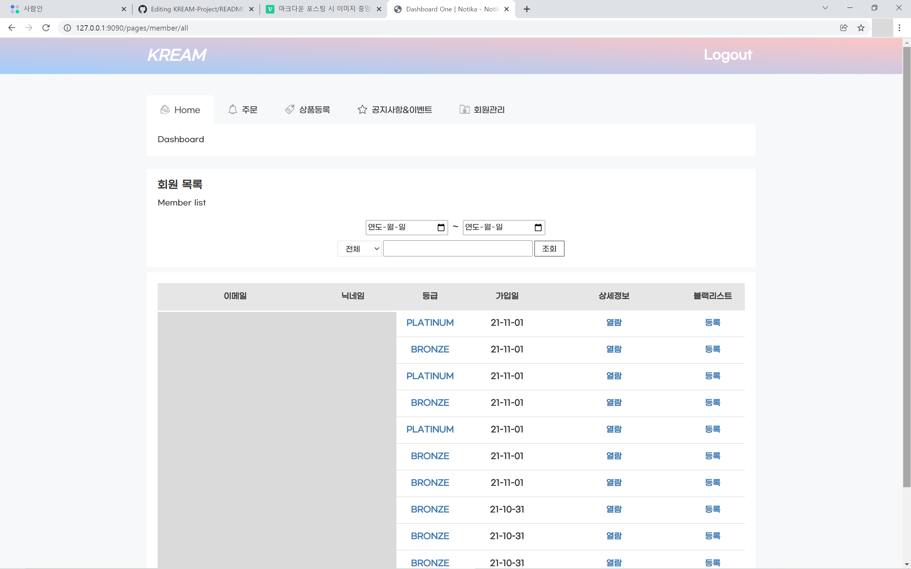
</details>

<br/>

## 리팩토링

프로젝트 종료 후 2022년 1월에 Service 계층 전체를 정리했습니다.

| 날짜 | 대상 |
| --- | --- |
| 2022.01.17 | Address, Customer, Product, Purchase, StyleImg, Transaction, Withdrawal, DashBoard, Follow, HashTag, ProductQna |
| 2022.01.18 | Product, ProImg, ProSize, ProductTag, Style |
| 2022.01.20 | 나머지 Service 전체 |

이후 공개 저장소 정리를 위해 SMS·DB·메일·네이버 로그인 설정값을 외부 설정 파일로 분리하고, 하드코딩된 로컬 경로를 프로젝트 기준 경로로 바꿨습니다.

<br/>

## 회고

### 어려웠던 점
팀원마다 파일 이름과 이미지 폴더 규칙이 달라서, 작업물을 합치는 데 시간이 오래 걸렸습니다.
기준 파일을 돌려가며 저장하다가 다른 사람의 작업이 지워지는 일도 있었습니다.
이 경험으로 프로젝트 초반에 폴더·경로 규칙을 정하고 GitHub로 협업 흐름을 맞추는 일이 얼마나 중요한지 알게 됐습니다.

### 배운 점
- 팀원 간 커뮤니케이션의 중요성과 웹 서버 구조를 몸으로 익혔습니다.
- 개발자 입장에서 완성된 서비스도 사용자에게는 부족할 수 있다는 걸 느꼈습니다. 프론트엔드 완성도를 높이려면 클릭 반응, 효과 같은 UX 디테일에 신경 써야 한다는 걸 배웠습니다.

### 보완할 점
- 데이터가 많아지면 조회 속도가 느려지는 문제가 있어, AWS 배포와 함께 성능을 개선할 계획입니다.
